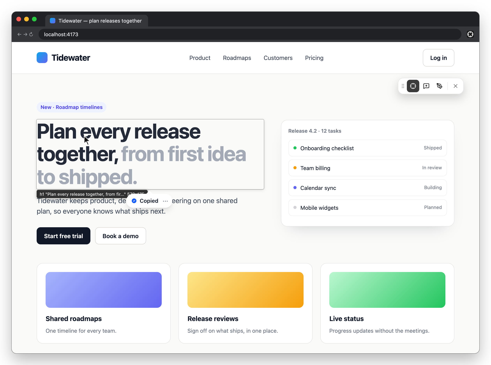
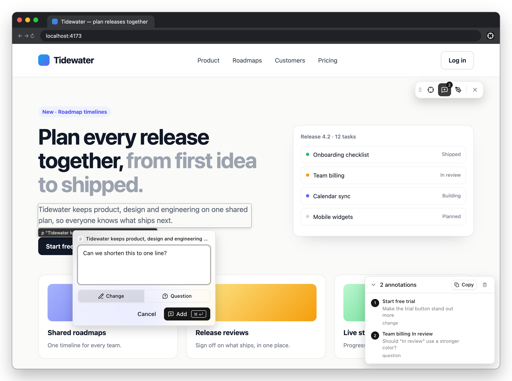
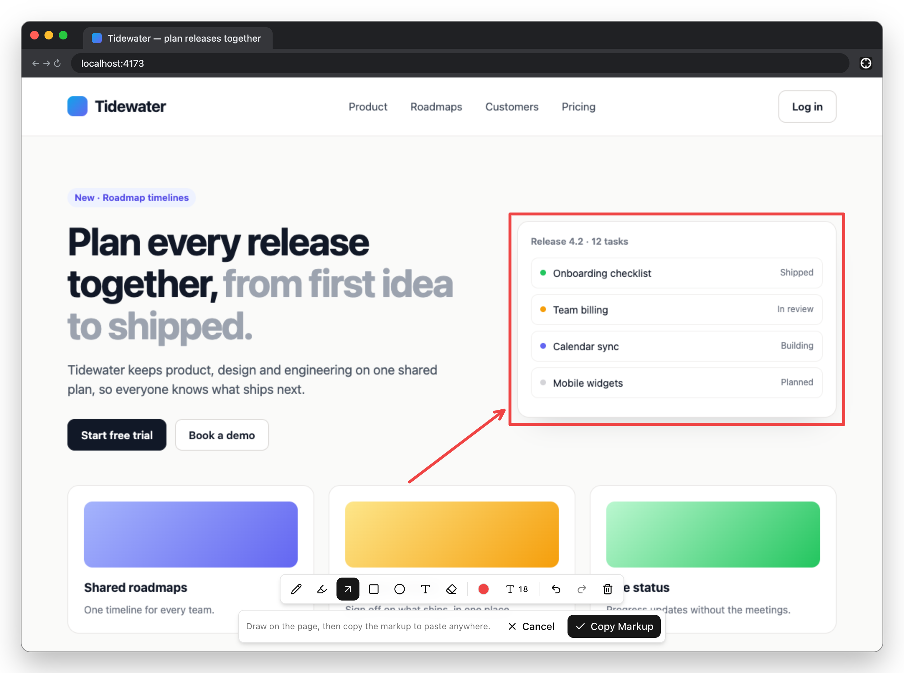

# Element Grab

Chrome extension that ports Orca's in-browser element tools to any tab: point at part of a
page and copy what it is, comment on it, or draw on it, then paste the result anywhere.

## Grab

Hover to highlight, click to copy the element's context: selector, accessible name, React
component tree, text, HTML, computed styles and nearby text. Right-click for a menu; while
hovering, `C` copies text and `S` copies a cropped screenshot without clicking. `Esc` exits.



Clicking the heading above copies:

```text
Attached browser context from http://localhost:4173/

Selected element:
h1
Role: h1
Selector: h1.hero-heading
React: <LandingPage> <Hero> <HeroHeading>
Dimensions: 579x175

Text content:
Plan every release together, from first idea to shipped.

Nearby context:
- New · Roadmap timelines
- Tidewater keeps product, design and engineering on one shared plan, so everyone knows what ships next.
- Start free trial Book a demo

Computed styles:
  display: block
  font-size: 54px
  color: rgb(17, 24, 39)

HTML:
<h1 class="hero-heading">Plan every release together, <span class="muted">from first idea to shipped.</span></h1>

Ancestor path: div > section > main > div > body
Full DOM path: body > div#root > main > section.hero > div > h1.hero-heading
```

## Annotate

Pick elements one by one and leave a **Change** or **Question** comment on each. They collect in
a tray and survive reloads within the tab. **Copy** turns them into one Markdown document.



The tray above copies (first item shown, the others follow the same shape):

`````markdown
## Design Feedback: /

**URL:** http://localhost:4173/
**Browser tab id:** 1224770057
**Viewport:** 1200x800

### 1. <LandingPage> <Hero> <CtaButton> button "Start free trial"
**Intent:** change
**Selector:** `button.btn.btn-primary`
**Location:** `#root > main > .hero > div > .hero-actions > .btn`
**React:** <LandingPage> <Hero> <CtaButton>
**Bounds:** x=64, y=476, 138x45
**Classes:** `btn btn-primary`
**Text:** "Start free trial"
**Nearby text:**
- Book a demo
**Nearby elements:**
- button.btn "Book a demo"
**Computed styles:**
- display: block
- width: 137.969px
- height: 44.5px
- margin: 0px
- padding: 10px 18px
- color: rgb(255, 255, 255)
- background: rgb(17, 24, 39)
- border: 1px solid rgb(17, 24, 39)
- border-radius: 10px
- font-family: -apple-system, "system-ui", "Segoe UI", Inter, system-ui, sans-serif
- font-size: 15px
- font-weight: 600
- line-height: 22.5px
- text-align: center
**Full DOM path:** `body > div#root > main > section.hero > div > div.hero-actions > button.btn.btn-primary`
**HTML:**
````html
<button class="btn btn-primary">Start free trial</button>
````
**Feedback:** Make the trial button stand out more

### 2. …
### 3. …
`````

## Markup

Freeze the viewport and draw on it (pen, highlighter, arrow, rectangle, ellipse, text, eraser,
undo/redo). **Copy Markup** puts the composed PNG on the clipboard.



## Install

**From a release:** download `element-grab-<version>-chrome.zip` from
[Releases](https://github.com/KinderRookie/element-grab/releases), unzip it, then open
`chrome://extensions`, enable Developer mode, **Load unpacked**, and pick the unzipped folder.

**From source:**

```sh
pnpm install
pnpm build            # → .output/chrome-mv3
```

Then **Load unpacked** `.output/chrome-mv3` (a hidden folder: press `Cmd+Shift+.` in the macOS
file picker).
For development, `pnpm dev` opens a Chrome with the extension and reloads on change.

## Use

The extension only runs on a tab after you invoke it (`activeTab`), so it needs no site access.

| Shortcut | Action |
|---|---|
| `Alt+Shift+E` / toolbar icon | Show / hide the floating toolbar |
| `Alt+Shift+G` | Grab |
| `Alt+Shift+N` | Annotate |
| `Alt+Shift+M` | Draw on screenshot |

Rebind them at `chrome://extensions/shortcuts`. After a reload or navigation the toolbar is gone
until you invoke it again; the tab's annotations come back with it.

Limits: top frame only (no cross-origin iframes); Chrome blocks extensions on `chrome://` pages,
the Web Store and the PDF viewer (the icon shows a red `!` there). Image copy needs an https or
localhost page.

## Develop

```sh
pnpm compile      # type-check
pnpm test         # unit tests (Orca's formatter, geometry and markup suites)
pnpm test:e2e     # Playwright: loads the extension into Chromium against a React fixture
```

README screenshots: `pnpm screenshots` drives the extension on the demo page in `docs/demo`.
Ported from [Orca](https://github.com/stablyai/orca) (MIT) — see `NOTICE`. Not affiliated with Orca.
